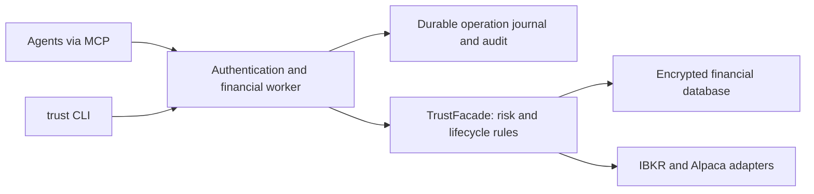

# Trust

Trust is a risk-management service for trading agents. Its purpose is capital preservation: size trades within an owner's loss budget, reduce size when performance deteriorates, allow recovery within hard ceilings, and block new exposure when safety checks fail. Agents use authenticated MCP tools; the service owns financial decisions, broker access and the auditable ledger.

Built in Rust, with **Interactive Brokers Client Portal** as the first broker for whole-account safety. One owner can delegate trading to multiple agents while keeping policy and capital changes behind human authentication. The Alpaca adapter remains available, but service funding/submission waits for its whole-account snapshot implementation.

[Set up the service](docs/service.md#running-the-service) · [Encryption and server security](docs/security.md) · [Agent skills](docs/skills.md) · [Tool catalogue](docs/reliability/features.md) · [Verification and limits](docs/reliability/verification.md) · [Documentation](docs/README.md)

For self-hosted identity, use the [Keycloak reference deployment](docs/authentication.md): owner sign-in with verified FIDO2 security keys, separate agent signing keys, short-lived tokens, and real browser/MCP compatibility tests. Physical YubiKeys and production recovery still need deployment acceptance.

The [patched identity images](docs/security.md#current-image-findings-2026-10-28) pass High/Critical dependency scans and real passkey/MCP tests against PostgreSQL, including restart recovery. CI checks all three runtime images. Production infrastructure and real IBKR acceptance remain required before live trading.

## What Trust enforces

- **Risk before execution.** Position sizing uses decimal arithmetic, available ledger capital, account levels, and per-trade/monthly limits. Funding and submission require configured risk rules; submission checks the current policy again.
- **Performance within hard ceilings.** Levels can reduce size or restore capacity after qualifying performance. Loss breaches take precedence over recovery and cannot be suppressed by the level-change limit. A winning streak never authorizes an agent to raise the owner's limits.
- **Whole-account limits.** IBKR positions and working orders, including manual activity, share exposure limits with reservations across agents and Trust profiles. Broker-equity daily loss and drawdown include unrealized P&L. Agents also have instrument, direction, notional, open-trade and expiry limits.
- **Persistent halts.** Uncertain financial mutations, stale broker evidence and reconciliation failures block new exposure across restarts. Protection and permitted exits remain available. Only the authenticated owner can resume after verified recovery.
- **Protective stops.** For a filled long trade, a stop can only move up; for a short trade, it can only move down. Checks use the strongest recorded protection, including verified audit history. The owner cannot override this rule.
- **Explicit trade state.** Preparing, reserving capital, submitting, filling, and closing are separate operations. Broker reconciliation confirms the resulting state.
- **Durable intent.** Every mutation requires a stable idempotency key. Intent is recorded before dispatch, and uncertain broker outcomes remain available for reconciliation instead of automatic resubmission.
- **Account-scoped authority.** Every request validates its access token and configured permissions. Agents receive neither broker credentials nor direct database access.

The [risk contract](docs/risk-contract.md) separates enforced controls from remaining work. Funding and submission enforce shared portfolio heat, gap stress, margin cushion, concentration, volatility/execution limits, drawdown throttling and agent activity budgets. Existing installations need explicit owner policies for these controls; missing policy or evidence blocks new exposure. Stops can execute beyond their planned price, so Trust cannot promise that an account cannot lose its capital.

Start each agent workflow with `account_readiness`. It explains blockers and current capacity; each tool returns a specific result schema and permitted next actions. The three bundled skills cover sizing, operations and owner administration. See [the MCP workflow](docs/service.md#agent-ux) and [agent evaluations](docs/reliability/agent-evaluations.md).

## Who can do what

| Identity | Authority |
| --- | --- |
| Owner, with recent human MFA | Change risk and allocation policy; record deposits, withdrawals, and transfers; administer accounts/instruments, backups, and manual execution accounting. |
| Trading agent | Preview risk, prepare trades, reserve existing capital, submit, reconcile, tighten stops, request exits, and maintain journals within its configured permissions. |
| Monitoring identity | Scrape global operational metrics with `trust:observe`; no financial tool or account-record access. |

The server has two roles: `owner` and `agent`. A monitoring identity uses the agent role with only the observation scope. Authentication comes from your existing OAuth/OIDC provider; owner MFA is enforced there and verified again by Trust. Keep owner credentials outside agent sessions.

Deposits and withdrawals record **ledger capital**; they do not transfer cash at the broker. See [authentication and permissions](docs/service.md#authentication-and-permissions) for token claims, scope/account grants, MFA configuration, and revocation.

## Run the service

Start with a paper account. You need an OAuth/OIDC provider, its public JWKS, private persistent storage, and the appropriate broker connection. For IBKR, that means an authenticated Client Portal Gateway; Trust does not automate broker login.

1. Copy [`deploy/config.example.json`](deploy/config.example.json) to `deploy/config.local.json`. Set the public URL, issuer, owner/agent subjects, and account grants. Configure the provider's human MFA context for owner actions. Keep `allow_live` disabled.
2. Put the provider's **public** JWKS in `deploy/jwks.json`. Configure your HTTPS reverse proxy and broker connection using the [operator guide](docs/service.md#running-the-service). For IBKR, set `TRUST_IBKR_URL` to the reachable Gateway endpoint and keep certificate verification enabled.
3. Follow the [encrypted-storage setup](docs/security.md#provision-keys-and-storage): provision three independent keys from protected custody onto a private RAM-backed directory, set `TRUST_SECRETS_DIR`, and set container ownership. Keep the host data volume, identity database and backups on encrypted disks.
4. Start the container:

   ```sh
   docker compose -f deploy/compose.yaml up --build -d
   ```

5. Check `/healthz` and `/readyz`, then connect an OAuth-capable MCP client to `https://YOUR_HOST/mcp`. Authenticate and call `service_status`.
6. Use the owner identity to create the paper account profile, record its ledger capital, configure risk rules, and resolve instruments. Assign the resulting account UUIDs to the agents' grants and restart the service.

Production startup requires encrypted financial/control databases and private RAM-mounted keys. MCP backups are encrypted with a separate key. The sample container binds to host loopback, runs without root, uses a read-only root filesystem, and keeps state in a private volume. It requires your configured identity provider and HTTPS ingress. The service owns its databases exclusively; do not share them with another writer or an agent container.

For native development, use the toolchain pinned in [`rust-toolchain.toml`](rust-toolchain.toml), then build and run with a local configuration containing writable storage paths and a matching loopback listener/public URL:

```sh
make native-sqlcipher  # Linux: C toolchain, Python 3.12+, make, pkg-config, OpenSSL headers
cargo build --locked -p trust-service -p trust-cli
./target/debug/trust-service /absolute/path/config.local.json
```

The optional `trust` CLI uses the same service. Set `TRUST_SERVICE_URL` and `TRUST_ACCESS_TOKEN_FILE`, then run `trust status` or `trust tools`. See the [terminal client reference](docs/cli-reference.md).

## Agent workflow

Begin with `service_status`, `policy_get`, and `accounts_list`. Read the `trust-risk` skill before taking risk, and use discovery to obtain the exact tool schemas and permitted actions.

1. Use `risk_check` with an instrument, bracket and quantity ceiling for fresh broker-aware admission sizing. `risk_preview` explains the local ceiling; `trade_hypothesis` calculates simple planned reward/loss.
2. Call `trade_prepare` with exact instrument/account IDs and decimal strings for money and quantity.
3. For IBKR, use `broker_preview` to inspect broker estimates and warnings. This preview does not override Trust's risk checks.
4. Call `trade_fund` to reserve capital, then `trade_submit` to send the persisted bracket.
5. Call `trade_reconcile` to confirm fills and accounting. Use `trade_modify_stop` to tighten protection or `trade_close` to request an exit, then reconcile again.

**After a timeout or uncertain response:** inspect `operation_get` with the original key and identity. Reconcile the trade before creating any new intent. An accepted submission is not a fill, and an exit request is not a confirmed close.

The [catalogue](docs/reliability/features.md) covers trading, capital, policy, reporting, instruments, market data, advisory analysis, sessions, journals, and administration. Three bundled skills are available through MCP resources and prompts:

| Skill | Purpose |
| --- | --- |
| [`trust-risk`](skills/trust-risk/SKILL.md) | Research markets and portfolio risk; size and prepare authorized entries. |
| [`trust-operations`](skills/trust-operations/SKILL.md) | Reconcile, manage protection, close trades, and handle uncertain outcomes. |
| [`trust-admin`](skills/trust-admin/SKILL.md) | Owner setup, policy, capital, and administrative workflows. |

[Install and use the skill package](docs/skills.md). Skills include worked tool calls and focused references for entries, partial fills, uncertain outcomes, protection and owner recovery. `skills_list` returns descriptions and file manifests; `skill_read` accepts an optional bundled reference `path`. A sizing request stays read-only, and a skill never grants trading or owner authority.

## Architecture and operations



One financial worker serializes operations. Bounded queues, deadlines, readiness checks, and graceful shutdown make overload and interrupted work explicit. An audit write or integrity failure stops financial admission. Financial storage and the control journal are separate: back up both while the worker is stopped.

Structured logs correlate HTTP/MCP requests, operations, and IBKR HTTP attempts without credentials or raw broker payloads. Operational logging uses a bounded background writer with dropped-line metrics; financial audit commits remain synchronous. Authenticated Prometheus metrics separate queue wait, JWT verification, tools, execution stages, and HTTP routes. Give a collector its own monitoring-only credentials.

See [observability and operations](docs/service.md#audit-logging-and-operations) for metric names, alert queries, and recovery procedures. Release E2E benchmarks include authentication, risk calculation, and synchronous auditing. Use `TMPDIR` on the intended storage filesystem when measuring performance; a memory-backed temporary directory excludes physical-disk flush cost. [Recorded measurements](docs/reliability/verification.md#observability-and-latency-acceptance-2026-10-27) include latency tails and their limits.

## Verification levels

Trust is beta software. Verification progresses through six levels:

| Level | Evidence |
| --- | --- |
| 1 — Deterministic | Risk arithmetic, property tests, policy admission, accounting rollback, and permissions. |
| 2 — Protocol | Real HTTP/MCP service processes and a local IBKR simulator, including replay, crash recovery, redaction, and deadlines. |
| 3 — Paper preflight | Authenticated IBKR paper identity, contract lookup, and non-submitting broker previews. |
| 4 — Paper lifecycle | Supervised orders, fills, fees, exits, and independent cash/position reconciliation. A submit/cancel smoke is insufficient. |
| 5 — Operations | Multi-session recovery, stale/external state, whole-account limits, alerting, halts, and restore acceptance. |
| 6 — Live canary | A separately owner-authorized, bounded real-money run after the preceding gates. |

Offline tests cover levels 1–2. Real IBKR acceptance and live readiness remain unverified. Whole-account broker exposure, persistent halts and equity limits are implemented and tested offline; their real-broker and operational acceptance remain outstanding. Planned stop prices cannot guarantee realized losses during gaps or slippage. Review the [assurance plan](docs/reliability/assurance.json), [edge cases](docs/reliability/edge-cases.md), and [IBKR test setup](docs/interactive-brokers-e2e.md) before progressing.

Run the offline checks:

```sh
make reliability          # Serialized workspace tests and named-regression evidence
make e2e                  # Real service processes with a local broker simulator
make assurance-mutations  # Prove selected tests fail when safety guards are removed
make ci-perf              # Release lifecycle and HTTP/MCP latency gates
make assurance-status     # Inspect current local evidence and unverified levels
```

These commands do not run real-broker tests. Broker-connected checks require explicit configuration and operator action; live orders are never run automatically by CI.

## Development

The Rust workspace keeps domain contracts in `model`, business rules in `core::TrustFacade`, the authenticated boundary in `service`, and persistence/broker translations in adapters. See [architecture](docs/architecture.md), [core concepts](docs/core-concepts.md), and [`AGENTS.md`](AGENTS.md) for the repository workflow.

```sh
cargo fmt --all -- --check
cargo clippy --locked --workspace --all-targets --all-features -- -D warnings
cargo test --locked --workspace --all-features -- --test-threads=1
```

The historical terminal application is retained as `trust-legacy` behind the `legacy-cli` feature for migration and regression coverage. It must not access a running service's database. `broker-sync` contains an actor/session scaffold; production websocket reconciliation is not wired into it.

Licensed under GPL-3.0-only.
