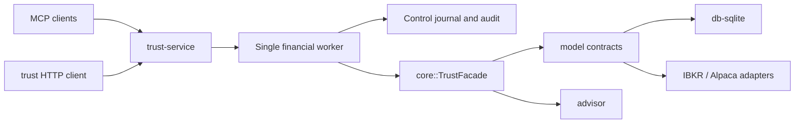

# Trust architecture

Trust is a service for risk-managed trading. MCP and the default CLI call the same authenticated boundary. The service owns identity, authorization, durable intent and recovery; core owns financial decisions. Broker credentials and financial storage stay on the server.



See [service operations](service.md), [the risk contract](risk-contract.md), [authentication](authentication.md) and [storage security](security.md) for the enforced behavior and deployment requirements.

## Repository map

Use `tree --gitignore -a -L 3 -I '.git'` from the repository root to inspect source without build products, local secrets or test artifacts.

```text
trust/
├── service/       HTTP/MCP, worker, control journal, authorization, skills delivery
├── core/          TrustFacade, risk engines, accounting and trade orchestration
├── model/         Domain types and Broker / DatabaseFactory contracts
├── db-sqlite/     Financial storage, migrations, atomic writes and encrypted backups
├── ibkr-broker/   Client Portal requests and broker-to-domain translation
├── alpaca-broker/ Alpaca requests and broker-to-domain translation
├── advisor/       Catalyst, correlation and regime analysis
├── security/      Private-file, encryption-key and secret handling
├── credentials/   Native credential stores for local adapters and legacy use
├── cli/           Default HTTP client plus optional trust-legacy compatibility binary
├── broker-sync/   Session actor and separate connection-state scaffold
├── skills/        Risk, operations and owner-administration agent workflows
├── deploy/        Service, Keycloak and PostgreSQL container configuration
├── scripts/       Assurance, identity setup, packaging and acceptance runners
├── docs/          Contracts, operations and verification records
├── tests/         Installer tests
└── .github/       Build, coverage, security, performance and release gates
```

The Cargo workspace contains eleven crates. Each crate's `AGENTS.md`, where present, describes its narrower ownership and verification requirements. The root Dockerfile builds the service, storage utility and default HTTP client.

## Responsibility boundaries

| Layer | Owns | Must delegate |
| --- | --- | --- |
| MCP/HTTP/CLI | Request presentation, discovery, schemas and responses | Financial decisions, storage and broker execution |
| Service | Verified identity, scopes/accounts, owner MFA, queueing, durable operation records, safety-state persistence and recovery | Risk formulas and financial mutations to core |
| Core | Sizing, portfolio admission, lifecycle validation, accounting, reconciliation, leveling and distributions | External representation and persistence details to adapters |
| Model | Exact-decimal entities, state and adapter contracts | Application workflows |
| Database/broker adapters | Translate and persist domain values; preserve account/contract identity and explicit errors | Risk policy decisions |

`service/src/catalog.rs` defines tool names, permissions and input contracts. `runtime.rs` validates and authorizes before claiming an idempotency key or dispatching work. `safety.rs` connects persisted whole-account state to core risk engines. `domain/` calls the facade; transports never submit directly to a broker. Output schemas, guidance and skill workflows are separate presentation modules, with contract tests covering their agreement.

## Financial and control storage

`DatabaseFactory` supplies account, order, trade, execution, fee and other financial readers/writers. `db-sqlite` implements them using Diesel and SQLCipher. Financial workflows use transactions/savepoints so partial failures cannot leave only some accounting writes committed.

The service's separately encrypted control database stores idempotency claims, operation outcomes, audit history, account safety policies, reservations, mandates and durable halts. It commits intent before financial dispatch. An unfinished operation after a crash is uncertain and must be reconciled; it is never automatically submitted again. A broker request and the two databases cannot share an atomic transaction. Back up both databases while the worker is stopped and retain externally anchored audit evidence.

Financial migrations live in `db-sqlite/migrations/`; control migrations live in `service/migrations/`. Both need paired migration files and preservation tests. Never edit the generated `db-sqlite/src/schema.rs` directly.

Build and test Make targets do not initialize or migrate the operator's legacy database. Tests create their own storage. `make setup`, `make migration` and `make clean-db` are explicit database operations; use a deliberate `CLI_DATABASE_URL` when invoking them. Ordinary test targets use the pinned lockfile.

## Trade and risk workflow

`DraftTrade` is creation input; a persisted trade starts at `New`. The main lifecycle includes funding, submission, partial/full fills and terminal outcomes. Every trade has entry, safety-stop and target orders. The authoritative transition rules and accounting effects are in `core/src/commands/trade.rs`; a diagram is not a substitute for those checks.

Funding and submission validate current account and trade state, owner policy, broker evidence, portfolio capacity and the agent mandate. Shared prospective loss reservations include all linked Trust profiles and observed external exposure. Submission rechecks current conditions; a preview does not reserve capacity. Existing stops may only tighten. Unknown financial outcomes, stale evidence and reconciliation failures can latch a durable halt; permitted protection and exits retain their normal authorization and lifecycle checks.

Closing a trade feeds leveling and conditional positive-profit distribution. Grading is an explicit operation. Execution and fee reconciliation must remain consistent with balances and the trade lifecycle. Detailed limits, formulas and remaining acceptance requirements are in [the risk contract](risk-contract.md).

## Clients, legacy code and broker synchronization

`cli/src/client_main.rs` builds the default `trust` HTTP client. Its normal dependencies are limited to the client stack; database, broker, advisor and native credential dependencies are optional and enabled by `--features legacy-cli`. Development dependencies retain existing facade regressions even when that feature is disabled. The default client can be built without SQLCipher or D-Bus development libraries; its HTTP/TLS dependencies still have their own build requirements.

`trust-legacy` uses `cli/src/main.rs`, the large dispatcher, dialogs and views. It remains a compatibility/testing surface and must never share a database with the running service. New product workflows belong in the service. Keep legacy JSON snapshots stable until an intentional migration retires their contract.

`broker-sync` is an in-memory session actor plus message types and a separate connection state machine. It does **not** provide production websocket reconciliation. The legacy watch command polls through the facade; the actor tracks its sessions. Production reconciliation is the service worker's bounded background polling. Wiring websocket events would require explicit acknowledgement, ordering, idempotency and recovery semantics.

## Verification and remaining debt

CLI subprocess tests use `cli/tests/support/mod.rs` for temporary database directories, disabled keychain access and Cargo's selected executable. They use the compile-time binary path rather than searching `target/debug`, which could select an old or non-instrumented executable during coverage. This follows [Cargo's integration-test binary support](https://doc.rust-lang.org/cargo/reference/cargo-targets.html#integration-tests). Each top-level integration-test file is already a Cargo target; do not import it into a second aggregator just to run it again.

The highest-value remaining structural cleanup is:

- Move facade/accounting regressions from `cli/tests/` to the crates that own those behaviors, preserving their cases and fixtures. This would reduce development dependencies as well as clarify ownership.
- Retire legacy command groups incrementally after their migration contracts and service replacements are proven. The large dispatcher includes substantial inline tests; a bulk deletion would lose useful evidence.
- Decide whether the broker-sync scaffold is still needed before expanding it. Its current session tracking is not evidence of websocket recovery.
- Continue replacing diagnostic-only legacy probes with business assertions. The unregistered workflow/Phase 2 drafts and the unused success-only `ProfitDistributionService::transfer_funds` placeholder have been removed. Transfers use `TrustFacade::transfer_between_accounts` with an explicit currency. Executable cash contracts and lifecycle replay tests cover persisted outcomes; see [test design](reliability/testing.md).

Run the workspace gates in [the repository guide](../AGENTS.md). The [verification record](reliability/verification.md) distinguishes offline evidence, real identity/client checks and broker-connected acceptance. Passing deterministic tests does not establish real IBKR fills, protection, fee fidelity or production readiness.

## Bounded command modules

The legacy CLI now uses a small Command invoker and focused workflow modules instead of the former 22,190-line dispatcher. [Command boundaries and size rules](command-boundaries.md) describe the enforced limits and the remaining size allowances. [Percentage, event, and history contracts](reliability/contracts-and-pagination.md) describe the financial compatibility and paging changes.
