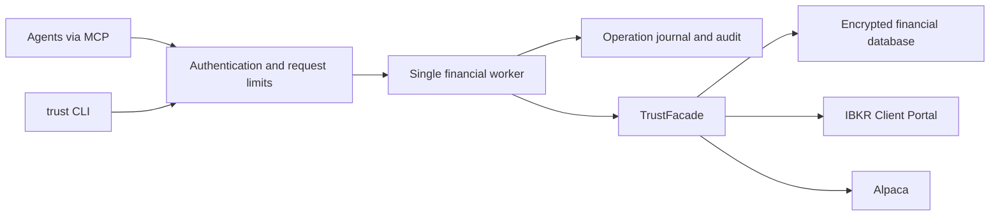

# Trust service and MCP

Trust owns sizing, risk policy, trade state, and the financial ledger. Agents use authenticated tools; they do not receive the database or broker credentials. The default `trust` terminal binary is a thin HTTP client of the same service.



The service is for one owner and multiple agents. It is a single process with one serialized financial worker, not a horizontally scaled broker gateway. Keep exclusive ownership of its financial and control databases. Do not run the legacy CLI or another writer against the service database.

## Authentication and permissions

The supported self-hosted reference is [Keycloak with owner security keys and separate agent assertions](authentication.md). Its local browser and official MCP SDK acceptance harness exercises real issuer tokens. Production ingress, physical authenticators and recovery need their own acceptance.

Use an existing OAuth/OIDC authorization server. Trust is the protected resource, not an authorization server. Register an API audience/resource equal to `https://YOUR_HOST/mcp`. Configure the provider to issue **RS256 access tokens** with `kid`, exact `iss`, that `aud`, a granted `sub`, `iat`, `exp`, and a space-separated `scope`. `nbf` is enforced when present. ID tokens and broker tokens are not Trust credentials.

Use a distinct provider service-account subject for each agent. The server intersects token scopes with the subject's configured scopes and explicit account UUIDs. Use `all_accounts` only for the owner/operator identity. `client_id` or `azp` is recorded as additional attribution. Human OAuth clients should use authorization code with PKCE at the provider; unattended agents use the provider's appropriate service-account flow. Register clients at the provider; Trust does not implement client registration or proxy its login endpoints.

There are two server-assigned roles: exactly one grant has `role: "owner"`; all other grants are `role: "agent"`. Missing roles default to agent. Agent grants cannot contain `trust:policy`, `trust:admin`, or `trust:manual`, and token claims cannot override the configured role. Existing configurations must explicitly mark the owner before restarting. The example agent grant permits account-scoped reads, sizing, trade preparation/funding/submission, protective order management, closing, broker reconciliation and journals. Assign only the accounts and actions that agent needs.

Owner-only actions include changing risk rules, levels and distribution policy; recording deposits, withdrawals and transfers; account/instrument administration; backup restore; and manual execution accounting. They require both their existing scope and a recent human MFA login. `trade_fund` reserves existing ledger capital for a validated trade and remains an agent action; it cannot credit new money. Deposits and withdrawals update Trust's ledger, not a broker cash-transfer API. Automatic distributions continue to follow the owner's previously configured policy.

Configure `owner_authentication.acr_values` with exact authentication-context values that your provider issues **only after enforcing human MFA**. The example `urn:trust:owner:mfa` is a deployment-specific policy name, not a standard assurance level or proof by itself. Configure the provider to include `acr` and the original `auth_time` in the signed **access token**, restrict the owner subject to the human login flow, and prevent service-account/client-credentials grants from asserting that context. Trust still accepts only its configured access-token issuer/audience; do not substitute an ID token. The default maximum login age is 300 seconds; configuration allows 1–900 seconds with no disabled mode.

An elevated owner token with missing, wrong, future or stale authentication evidence receives HTTP 401 with an `insufficient_user_authentication` challenge, the allowed `acr_values`, and `max_age`. Follow the provider's human authorization flow using those values and PKCE. This follows the [OAuth step-up authentication protocol](https://www.rfc-editor.org/rfc/rfc9470.html). Refreshing an access token cannot reset the original login time. The worker checks freshness again before dispatch and before replaying an existing result. Owner tokens containing only trading/read scopes do not need step-up; agent tokens never gain owner authority through MFA claims or extra scopes. Keep elevated owner credentials in the human client, outside agent sessions, prompts and tool arguments.

`/v1/tools` labels owner actions with `owner_only`; MCP discovery hides them from agents and labels them for owners. `policy_get` and `service_status` expose the caller's role. Audit events record the configured role and the verified owner-authentication deadline; no password, key, bearer token or raw authentication claim is logged. Startup recovery records an unknown role rather than inventing the original actor's authority.

| Scope | Authority |
| --- | --- |
| `trust:read` | Account reads, reporting, market data, own permitted operation/audit results, skills |
| `trust:preview` | Risk, trade, grading, broker, and advisory previews |
| `trust:trade` | Prepare, fund, submit, cancel, close, modify brackets |
| `trust:reconcile` | Broker-driven reconciliation |
| `trust:manual` | Privileged manual fill, stop and target accounting |
| `trust:journal` | Session plans, grades, events, catalysts, mistake reviews |
| `trust:policy` | Ledger capital, rules, levels, advisory policy, profit allocations |
| `trust:admin` | Account/instrument administration, audit verification, backup artifacts |
| `trust:observe` | Global operational metrics only, with an all-accounts grant; no financial tool access |

Live mutations require both service `allow_live` and the subject's `allow_live`. Both default to false. Transfers require both accounts; account mutations also check child accounts because closure/reconciliation can distribute profits. Tool discovery reflects granted scopes, and every call checks authorization again. A stored result is re-authorized against its original affected accounts before replay.

Mount the provider's **public** JWKS at `jwks_file`. JWKS keys, grants, token-ID revocations, and configuration are loaded on startup. Rotate public keys with an overlap period and restart; they are not fetched automatically. Remove a grant or add `jti` to `revoked_token_ids` and restart for emergency revocation. There is no token introspection endpoint. Keep access-token lifetimes short; the default maximum is one hour. No OAuth token is forwarded to a broker.

MCP clients discover the authorization server through `/.well-known/oauth-protected-resource/mcp` and the HTTP `WWW-Authenticate` challenge. Connect an OAuth-capable MCP client to `https://YOUR_HOST/mcp`. Protocol handling uses the official [Rust SDK](https://github.com/modelcontextprotocol/rust-sdk), including stateless Streamable HTTP and older initialize-based clients. Configuration follows the MCP [authorization specification](https://modelcontextprotocol.io/specification/2026-07-28/basic/authorization).

## Running the service

1. Copy `deploy/config.example.json` to `deploy/config.local.json`. Set your actual issuer, public origin, subjects, and account grants. Replace placeholder UUIDs after the owner creates account profiles. Never copy a private signing key into this configuration.
2. Put the provider's current public JWKS in `deploy/jwks.json`.
3. Configure your HTTPS reverse proxy to forward to `127.0.0.1:8000`, preserving the **public Host** and Authorization header. No wildcard Hosts or Origins are accepted. Keep `allowed_origins` empty for non-browser clients; add exact origins only when needed.
4. Complete [encryption and key provisioning](security.md#provision-keys-and-storage), including `TRUST_SECRETS_DIR`, private UID 10001 storage and root/UID 10001 configuration ownership. Configure the broker connection and optional RAM-backed secret mounts described below.
5. Run `docker compose -f deploy/compose.yaml up --build -d`. Check `/healthz` and `/readyz`, then authenticate and call `service_status`.

The sample binds only the host loopback port. HTTPS termination is deliberately delegated to your existing proxy. It does not publish a domain, create an IdP, or expose IBKR's gateway. Public URL/issuer must use HTTPS except for a loopback-only local development listener. For a native local process:

```sh
make native-sqlcipher
cargo build --locked -p trust-service -p trust-cli
# Use a local config with listen=127.0.0.1:8000 and matching public_url.
./target/debug/trust-service /absolute/path/config.local.json
```

The image runs as UID/GID 10001. The persistent volume, any imported files, and secrets must be readable/writable by that identity as appropriate. It has a read-only root filesystem, dropped capabilities, `no-new-privileges`, memory/CPU/PID limits, a bounded `/tmp`, and a graceful stop period. Database files are created with mode 0600. Use a private directory/volume and encrypted storage. Do not share that volume with agent containers.

The builder uses Rust 1.99.1 and the runtime uses Wolfi with current SQLite, OpenSSL, and native D-Bus libraries. Both base images are pinned by digest. The runtime package inventory is retained for vulnerability scanning. Rebuild with `docker build --pull` when applying dependency updates; changing `Cargo.lock` does not update a running container.

### IBKR

Set `TRUST_IBKR_URL` to the authenticated Client Portal Gateway endpoint, reachable from the container. The sample uses `https://host.docker.internal:5000/v1/api`; configure the gateway/listener and certificate trust for your network. Keep certificate verification enabled. An authenticated Gateway session and appropriate market-data/trading permissions remain operator responsibilities; Trust does not automate IBKR login or bypass MFA.

The adapter requires IBKR's explicit `isPaper` session field to agree with the account environment and rejects missing or conflicting evidence before selecting an account. See [IBKR tradable accounts](https://www.interactivebrokers.com/docs/web-api/api-reference/trading/trading-accounts/get-brokerage-accounts).

The HTTP client disables automatic retries and redirects. A failed mutation returns to the durable operation/reconciliation workflow instead of being automatically repeated or forwarded to another endpoint.

Create the account with `broker: "ibkr"`, the exact `broker_account_id`, and explicit environment. Use `instrument_resolve` to import a contract's native ID; preserve bond terms through `instrument_update`. `broker_preview` uses IBKR's existing `/orders/whatif` integration through the broker trait. Commission and margin amounts have independent currency availability. Missing values, ambiguous ranges, or unknown currencies are not inferred from the trade.

The service retains Client Portal as the working adapter. It does not claim to implement IBKR OAuth2, FIX, TWS, or another provider's full trading framework. Those can be added behind `Broker` while Trust remains the risk authority.

### Alpaca and other secrets

Whole-account snapshot admission is currently implemented for IBKR. Alpaca service funding and submission fail closed with `broker_snapshot_unavailable`; do not migrate an active Alpaca deployment expecting new entries until its complete snapshot contract is implemented and accepted. Existing adapter capabilities and risk-reducing workflows remain independently tested.

For containers, set `TRUST_ALPACA_CREDENTIALS_FILE` to an individually mounted file whose top-level keys are Trust account UUIDs:

```json
{
  "ACCOUNT_UUID": {
    "environment": "paper",
    "key_id": "PROVIDER_KEY_ID",
    "secret": "PROVIDER_SECRET"
  }
}
```

The adapter selects official paper/live endpoints and rejects environment mismatches. When this variable is set, missing/invalid file entries fail closed; there is no keychain fallback. Existing local keychain use remains available outside containers. Files are operator-managed and never tool results.

Optional service configuration accepts `distribution_password_file` and `calendar_credentials_file`. The latter contains `provider` and `api_key`, using an existing advisor calendar provider. Absent calendar configuration produces the advisor's explicit unavailable/provider warning. Credential setup, rotation, deletion, and inspection are operator workflows, replacing the old agent-facing key commands.

## Agent UX

Start with `service_status`, `policy_get`, and `accounts_list`. Tools use exact IDs, decimal strings, explicit accounts, and descriptive names. The normal workflow is:

`account_readiness → risk_check → trade_hypothesis → trade_prepare → broker_preview (IBKR) → trade_fund → trade_submit → trade_reconcile`

Preparing does not reserve capital. Funding does not submit an order. Submission is not a fill. `trade_close` requests an exit; reconciliation confirms the resulting state. A broker preview never overrides Trust's sizing and funding checks.

`risk_preview` accounts for short stop collateral and never advertises a level-adjusted size above the enforced base capital/risk ceiling. A monthly rule is enforced even without a per-trade rule. Zero percent deliberately blocks new risk. Service funding and submission require both per-trade and monthly rules. The legacy local accounting API can still represent accounts without them. Submission revalidates current caps, level and ledger capital, crediting only the trade's own verified reservation in the calculation; a prior funding decision cannot override a changed policy. Monthly accounting uses UTC boundaries and the ledger's original entry basis for carried positions; it does not measure broker mark-to-market drawdown. Planned stops cannot guarantee realized losses during gaps or slippage.

Manual execution tools (`trade_record_fill`, `trade_record_stop`, `trade_record_target`) require the separate `trust:manual` scope in both token and grant, plus the actual execution `price` and `fee` as exact decimal strings. The price must come from execution evidence. Recording a manual execution persists the filled quantity and actual price for subsequent accounting and reconciliation.

Stop protection is a domain invariant for both roles: after a fill, long stops may only move up and short stops may only move down, using positive prices and the strongest recorded protection across the current stop, confirmed amendments and recorded broker observations. A stop that already protects profit cannot be loosened even if it would still be profitable. Stale client snapshots, weaker subsequent broker snapshots and owner authentication do not reset that bound. Accounting still records the latest observed broker state rather than pretending a stronger stop is active. Older sync records without price fields cannot reconstruct unrecorded historical observations; existing confirmed amendment prices remain usable. Invalid or risk-increasing changes fail before broker I/O; unknown earlier modifications must be reconciled before another change. Other lifecycle states retain their existing restrictions; this does not introduce partial-fill stop amendment support.

Tools cover the existing workflow families:

| Workflow | Tools |
| --- | --- |
| Accounts/capital | `accounts_list`, `account_get/create/delete`, `balances_get`, `transactions_list`, `capital_deposit/withdraw/transfer` |
| Instruments | `instruments_list/stats`, `instrument_create/update/resolve` |
| Risk/orders | `risk_rules_list`, `risk_rule_create/remove`, `risk_check`, `risk_preview`, `trade_hypothesis`, all `trade_*` lifecycle tools, `broker_preview` |
| Reconciliation/evidence | `account_reconcile`, `executions_list`, `trade_audit`, `operation_get`, `audit_list/verify` |
| Reports | `report_get` (summary, performance, drawdown, risk, concentration, metrics, attribution, benchmark, timeline, bias, wash sales, tax), `metrics_get` (advanced, compare, bond) |
| Levels/profit | `level_get/history/progress/evaluate`, `level_policy_get/set`, `distribution_policy_get/set`, `distribution_execute/history` |
| Review/planning | `trade_events_list`, `trade_event_record`, `trade_mistakes_list`, `trade_mistake_record`, `grade_get/preview/record`, `grades_list`, `sessions_list`, `session_open/close` |
| Advisory/market | `advisor_status/check/configure/history/correlation/regime`, `trade_catalysts_scan`, `market_snapshot/bars/quote/trade/session/stream` |
| Operations/skills | `connections_status`, `backup_export/restore`, `skills_list`, `skill_read` |

`GET /v1/tools` or MCP `tools/list` is the authoritative catalog with exact fields. `market_session` reports snapshot context, not an exchange-calendar guarantee. Market streams are finite batches. Advisor history is currently process-local; service audit and mutation outcomes are durable. Tax/wash-sale reports explicitly cover the full ledger. Currency aggregation is rejected when currency conversion would be required.

Three packaged skills with worked examples and supporting references are also MCP resources and prompts: `trust-risk`, `trust-operations`, and `trust-admin`. Read `trust://skills/trust-risk`, use `skill_read`, or install the corresponding directory under `skills/` into your agent's skill location. The admin skill is only exposed to identities with admin scope. These workflows guide use; they grant no permissions. `skills_list` returns descriptions, versions and file manifests; `skill_read` accepts an optional exact bundled `path`. References are also resources such as `skill://trust/trust-risk/references/trade-entry.md`. See [installation, client compatibility and skill usage](skills.md).

Prompts accept `account_id` and optional `trade_id` UUID arguments. Account access is checked before contextual guidance is returned; use `trade_get` to confirm the trade belongs to that account. Freeform instructions are not accepted as prompt parameters. See [actual agent evaluations](reliability/agent-evaluations.md) for discovery, recovery and injection tests.

### Broker-account safety and readiness

An existing installation needs explicit owner setup before new funding/submission: both legacy risk rules, `account_safety_policy_set`, a successful `account_refresh`, and an `agent_mandate_set` for each trading agent. Policies and durable halts are keyed by broker, environment and native account ID, so aliases in Trust cannot multiply the available budget. Policy changes, mandate changes, explicit halts and recovery require grants for every linked profile. Agents cannot fund or submit another actor's draft.

The required typed `controls` object adds broker-equity heat/trade/stress percentages, conservative margin buffer and maintenance stress, gross concentration by owner instrument/sector/group, quote/history/ATR requirements, liquidity/cost limits, explicit instrument entry schedules and drawdown steps with delayed recovery. Agent mandates require typed daily `risk_budget` limits. Legacy missing fields block admission instead of receiving permissive defaults. All decimal amounts are strings. See the [risk contract](risk-contract.md) and the bundled admin setup reference for exact semantics and deployment limitations.

`risk_check` is a draft-free read-only preview over fresh broker, margin and contract market evidence. It returns a conservative quantity within the requested ceiling, exact modeled losses, source times, binding blockers and `reserves_capacity: false`. Funding/submission re-fetch and revalidate; a preview cannot reserve an allowance. Ordinary read audit records apply, but the preview does not persist safety refreshes or clear a halt.

The policy sets exact-decimal gross exposure, per-order notional, daily equity loss and drawdown limits in one currency, plus a maximum snapshot age of 1–120 seconds. Admission counts absolute external/manual positions, working entries and all funded Trust reservations. Known bracket exits are excluded only when their identities, side and quantities reduce confirmed exposure. Unknown/unbounded orders, missing protection, unsupported assets/multipliers, mixed currencies and incomplete evidence block new risk. An accepted snapshot comes from two position/order passes around ledger and summary reads; it is bounded consistency evidence rather than an atomic broker transaction.

Daily loss and drawdown include broker unrealized P&L. The baseline starts at the **first accepted observation**; it cannot reconstruct earlier same-day losses. UTC rollover preserves overnight changes and the high-water mark. An unexplained difference between equity changes and P&L changes halts admission. Record an independently verified external deposit/withdrawal using `account_cashflow_record`; it adjusts the equity baseline without moving cash or creating ledger capital. A broker P&L counter reset needs owner `account_equity_reconcile` with a unique evidence reference and explicit cash-flow amount (`"0"` for a verified counter-only reset). This retains actual equity loss/high-water history and does not clear the halt. Never label trading losses as deposits or withdrawals.

`account_readiness` is a cached account view: connectivity, source/receipt times, policy completeness, current blockers, unresolved financial operation count and permitted new-notional capacity. Agent responses expose their own mandate and aggregate headroom without other agents' records; a globally authorized owner can inspect the full broker snapshot and equity baseline. `ready_for_new_risk` means the checks represented by the view passed; `constraints.max_new_notional` may still be zero and instrument/intent checks remain required. Use `risk_check` for the combined conservative quantity ceiling; also respect verified instrument increments and the mandate. Notional headroom is not loss capacity. `connections_status` uses the same evidence rather than reporting an unprobed connection. Neither view replaces fresh admission immediately before funding/submission.

Stale evidence, unknown financial mutations, reconciliation failures and equity breaches latch a persistent halt. Successful refresh, a later profit, policy edits and service restarts cannot clear it. Failed advisory/market reads do not create financial uncertainty. Session/journal writes retain their own uncertain operation record but cannot change cash, orders or enforced policy, so they do not halt financial admission.

Recovery is explicit: inspect the original operation, refresh the broker, reconcile affected trades and independently verify orders, positions, cash and fees. The owner records `operation_resolve` with evidence for each unresolved financial operation, then calls `account_resume`. Resolution preserves the original non-replayable intent; it does not fabricate a successful response. Resume checks fresh evidence, exposure, losses, protection and remaining unknowns. Permitted cancellation, stop tightening and exits remain available while halted, subject to their normal lifecycle/authorization checks.

Periodic reconciliation visits broker-account scopes in rotation. Size its interval for the number of scopes and broker response latency so every account fits its freshness budget; stale state fails closed. Broker calls share the serialized worker and can dominate latency. Before production, measure this polling budget and alert delivery with the actual gateway and storage.

### Results and retries

Every call returns `schema_version`, `request_id`, `operation_id`, `generated_at`, typed `data`, `error`, `actions`, and `next_actions`. Each MCP tool publishes its own output schema, including exact decimal strings and timestamps. Errors have stable `code`, safe `message`, `next_action`, and `retryable`. Each action supplies a tool, known arguments, missing required arguments, availability and blockers based on current permissions/broker/trade state. Guidance is not authorization. Historical replies can omit the newer additive fields. Array reads use `items`, `total`, and `next_offset`; defaults return 100 items, maximum 200. Nested reports are limited by the total response budget; narrow queries when needed.

Every mutation requires a unique `idempotency_key` (8–128 characters). A key is scoped to the authenticated subject and permanently bound to its exact tool/arguments. Use the same key and arguments after a timeout. Different arguments with the same key are a conflict. Different agents should not independently issue the same financial intent; core trade state/intent validation remains the second protection.

The journal commits intent before dispatch and commits the result afterward. An interrupted `running` operation becomes `outcome_unknown` on restart and is never automatically replayed. Broker failures after dispatch are conservatively uncertain unless a typed domain validation proves rejection. Use `operation_get` and reconcile; do not create another key to bypass uncertainty. Financial SQLite, control SQLite, and a remote broker cannot share an atomic transaction. This design does not claim exactly-once external execution.

### Fractional risk policy migration

Control migration `0002_account_safety` adds shared safety state, owner operation resolutions and versioned safety evidence. Each state change commits atomically with its audit hash and historical record. Current state must match the latest history; missing, altered or rolled-back state fails closed. Global owner audit reads expose the historical evidence; agents never receive other agents' mandates or broker snapshots through it. Retain both databases and externally anchored audit heads. History is append-only application evidence and grows with refreshes; provision storage and an audited archive/retention process rather than deleting rows to reclaim capacity.

Migration `2026-10-26-000001_preserve_fractional_risk` adds a decimal-string column while preserving existing integer policy values. It is an additive startup upgrade, with paired migration files and backup/restore tests. Downgrade refuses policies that would lose a fraction. Older backups still require a matching migration manifest: restore with their matching schema and then migrate the database.

Earlier storage truncated fractional percentages: a requested `0.3` could already be stored as `0`. The migration cannot reconstruct lost input. Inspect existing risk rules and deliberately correct them if needed; migration never increases a policy automatically. New percentages must round-trip through the legacy model boundary without changing their decimal value.

Run `make reliability` for the offline suite and named-test evidence. The [feature inventory](reliability/features.md), [edge-case register](reliability/edge-cases.md), and [verification record](reliability/verification.md) describe covered behaviors and remaining external acceptance work.

### Thin terminal client

```sh
export TRUST_SERVICE_URL=https://trust.example.com
export TRUST_ACCESS_TOKEN_FILE=/run/secrets/trust-access-token
trust status
trust tools
trust skill trust-risk
printf '%s\n' '{"account_id":"ACCOUNT_UUID","entry":"100","stop":"95"}' | trust call risk_preview
trust call trade_prepare --input draft.json
```

The CLI has no broker/database commands in its default entry point. It accepts tokens through a file, rejects credential-bearing URLs, and does not follow redirects with Authorization. Results are JSON. Obtain/refresh its access token using your provider's client tooling.

The historical CLI is retained solely as `trust-legacy` behind `--features legacy-cli`, including its JSON snapshot suite. Its command syntax is documented in [the legacy reference](legacy-cli-reference.md). Do not run it against a service-owned database. Deleting that implementation can be a later cleanup once migration users no longer need it.

## Audit, logging, and operations

Structured JSON logs go to stdout. HTTP and MCP calls share a generated `request_id` with their response and durable audit records. Operation logs include the tool, source (`http`, `mcp`, `internal`, or `background`), operation ID when available, queue wait, execution duration, replay flag, and safe error code. Core execution/fee reconciliation failures use sanitized operational events. Authorization headers, raw paths/queries, arguments, credentials, and broker response bodies are excluded. Container rotation bounds local logs; send them to your existing collector for retention.

Operational stdout uses a dedicated writer with a 2,048-line bounded queue. A stalled collector drops operational lines and increments `trust_log_dropped_lines_total`; it cannot block the financial worker. This counter measures enqueue failures, not collector delivery acknowledgements. The shutdown guard attempts to flush pending lines. Operational logs are best-effort; financial intent, outcomes and audit events still require synchronous durable journal commits. IBKR HTTP attempts emit `broker_request` with a fixed endpoint class, method, status, microsecond duration and outcome. The enclosing operation span supplies correlation without logging broker account/order identifiers, URLs or response bodies. No retries are added by instrumentation.

Audit version 2 adds source, affected account IDs, timing, and error code to the append-only hash chain. It records invalid authenticated tool arguments, authorization denials, key conflicts, replays, and interrupted-operation recovery as well as intent/results. Recovery changes state and appends evidence in one control-database transaction. `audit_list` returns `previous_hash` and `event_hash`, and requires access to every affected account even for the original actor. Version 1 hashes remain verifiable; old events retain their original account attribution. Mutation responses contain financial data and require the same protection as the ledger.

Audit write failure or a detected integrity failure stops the financial worker. Startup verifies the chain. Storage control could permit rewriting or truncating the entire chain, so retain external head hashes or trusted backups. Rejected authentication/HTTP requests and work canceled before dispatch appear in structured logs and metrics, not the financial operation journal; no durable financial intent has started. A client that disconnects after dispatch must inspect the original key.

`GET /metrics` exports Prometheus text, requiring a valid bearer token with `trust:observe` and an all-accounts grant. An elevated owner with `trust:admin` remains supported. Give the collector its own agent-role subject with only `trust:observe` in both its configured grant and access token; it can scrape without human MFA and cannot call any financial tool or read account records. See the monitoring grant in `deploy/config.example.json`. Use the configured issuer/audience, short-lived tokens and normal revocation; have the collector's credential integration renew tokens, rather than storing an owner session. All-account permission is required because metrics describe the whole worker.

Metrics read process-local counters without entering the financial queue, including when that worker has stopped. Scrape through the same authenticated TLS ingress as MCP. Label values come only from the immutable tool catalogue plus `unknown`, seven route classes, five execution stages and four HTTP outcome classes. Account IDs, subjects, raw caller tool names and keys never become labels. Counters reset on process restart; durable outcomes remain in the journal. Each histogram scrape takes a consistent snapshot of its cumulative buckets, count and sum, including during concurrent requests.

| Signal | Use |
| --- | --- |
| `trust_worker_ready`, `trust_worker_active` | Alert on an unavailable worker or prolonged execution. |
| `trust_queue_depth`, `trust_queue_capacity`, `trust_queue_rejections_total` | Detect queue saturation; canceled entries count until drained. |
| `trust_queue_wait_milliseconds`, `trust_execution_milliseconds`, `trust_http_duration_milliseconds` | Histograms with bounded cumulative buckets, count and millisecond sum. Separate queueing from execution latency. |
| `trust_operations_total`, `trust_operation_errors_total`, `trust_replays_total` | Completed dispatch attempts, errors and idempotency replays. |
| `trust_queued_cancellations_total`, `trust_unknown_responses_total` | Distinguish skipped queued work from callers losing confirmation of active work. |
| `trust_audit_failures_total` | Stop financial traffic and investigate storage or integrity immediately. |
| `trust_http_requests_total`, `trust_http_rejections_total` | HTTP totals and non-success transport responses; tool errors are counted separately. |
| `trust_queue_wait_seconds`, `trust_execution_seconds`, `trust_http_duration_seconds`, `trust_authentication_seconds` | Microsecond-resolution histograms exported in seconds, with buckets starting at 50 microseconds. Existing millisecond families remain available; fractional milliseconds contribute to their aggregate sums. HTTP timing ends when the handler returns response headers, not when a streaming body finishes. |
| `trust_tool_duration_seconds{tool}`, `trust_tool_errors_total{tool}` | Separate tool latency/errors, including replays and denials. Histogram count is the tool dispatch-attempt count. Unknown names share one bucket. |
| `trust_stage_duration_seconds{stage}` | Separate schema validation, account/scope authorization, journal claim, domain execution and journal completion. Claim includes replay lookup/auditing. Domain includes broker I/O; rejected or replayed requests do not execute that stage. Completion includes denied/invalid read auditing. |
| `trust_http_route_duration_seconds{route}`, `trust_http_responses_total{route,outcome}` | Separate transport/control routes and bounded status classes, including failures before financial dispatch. |
| `trust_log_dropped_lines_total` | Alert on loss of operational log lines; investigate the collector independently of durable audit health. |

Example PromQL for p95 tool latency: `histogram_quantile(0.95, sum by (le, tool) (rate(trust_tool_duration_seconds_bucket[5m])))`. Compare stage latencies using `histogram_quantile(0.95, sum by (le, stage) (rate(trust_stage_duration_seconds_bucket[5m])))`. Alert immediately on `increase(trust_audit_failures_total[5m]) > 0` or an unavailable worker; investigate `increase(trust_log_dropped_lines_total[5m]) > 0`, queue rejections, unknown outcomes and failed scrapes. An HTTP 200 can contain a tool error: include `trust_tool_errors_total` in error-rate panels. Timing recorded inside an audit event precedes that event's own commit; the operation metrics/log duration includes completion. These conventions follow [Prometheus naming guidance](https://prometheus.io/docs/practices/naming/) and its [instrumentation guidance](https://prometheus.io/docs/practices/instrumentation/).

`make service-perf` runs an offline release-profile benchmark against real service processes over HTTP and MCP. It retains JWT validation, risk calculation and FULL-synchronous read auditing, verifies every measured read is audited and the audit chain remains valid, and asserts that no broker order was submitted. It reports p50/p95/p99/max for 32 sequential requests and 64 requests in four-request batches after six warmups per transport. Budgets are p95 below 50 ms sequentially and 200 ms at concurrency four; these are portable CI regression budgets, not a broker or production latency guarantee. Tokens are signed outside the timed region. `make ci-perf` includes this gate and the existing annual/1,200-lifecycle benchmarks. The immutable tool catalogue is shared, but permissions and financial state are checked on every request; reconciliation reuses verified audit history only within its current atomic savepoint.

The fixtures use the OS temporary directory, which can be memory-backed. Set `TMPDIR` to a private scratch directory on the intended storage filesystem when checking disk latency. Compare equivalent storage and load conditions; neither loopback timings nor FULL-synchronous SQLite configuration demonstrate survival of real host power loss.

Request bodies are limited to 128 KiB, results to 1 MiB, ordinary concurrent HTTP requests to 32, the worker queue to 64 by default, ordinary total requests to 600/minute and each subject to 120/minute. Health/readiness probes bypass ordinary rate and concurrency limits. Authenticated metrics bypass the concurrency limit but remain rate limited.

`request_timeout_ms` defaults to 45000 (valid range 1–45000). `queue_timeout_ms` defaults to 40000 and must be between 1 and the request timeout. An expired queued request returns `request_expired` and cannot later execute. Retry its original key after pressure subsides. Once dispatch starts, a lost completion response is `outcome_unknown`: inspect `operation_get` with that key and reconcile before any new intent. SIGTERM immediately stops admission, finishes the active operation, rejects queued work, then joins the worker; forced termination preserves durable intent for recovery.

Background reconciliation runs independently of MCP connections, when configured, rotating through one active trade per interval. `account_reconcile` processes a bounded page (default 1, maximum 5); follow `next_after_trade_id` with a new key for the next page. Failures are recorded per trade and a batch's `complete` flag must be checked. The current synchronous adapters serialize broker I/O; a large account can delay other operations. Use an operator monitor for readiness, unresolved operations, and reconciliation failures. The service is not a substitute for broker-native protective orders.

For disaster recovery, stop the service and back up the financial database, control database (including SQLite WAL state if present), and configuration together; protect secrets separately. `backup_export` creates an opaque server-owned SQLCipher financial artifact using an independent backup key, not a full deployment backup. Encrypted restore requires that key; there is no plaintext service fallback. Follow the [migration, rotation and recovery procedure](security.md#migrate-plaintext-databases-and-rotate-keys). Online `backup_restore` is strict import into an empty financial database. In-place replacement must be performed offline after broker reconciliation; restoring a database cannot undo a live order. Keep the control journal to avoid forgetting past keys.

## Validation

Dependency maintenance covers the Rust toolchain, all workspace manifests and the lockfile, container images, and GitHub Actions. Dependabot proposes weekly Cargo, Docker, and action updates; CI also runs weekly to detect new advisories. Actions and base images use immutable pins. Security tools use explicit versions and locked installation.

`cargo audit --deny warnings` and `cargo deny --all-features check` are blocking checks with no advisory exceptions. The production image must pass a high/critical vulnerability scan, including findings without a published fix. Native credential access uses `keyring-core` and explicit maintained OS backends; it preserves service/username identifiers and never falls back to an in-memory store on initialization failure.

Rusqlite is on 0.40.2 because Diesel 2.3.14 requires `libsqlite3-sys <0.39`, while Rusqlite 0.41 requires 0.39. Upgrade them together when their native-library requirements agree. This compatibility constraint is recorded in `service/Cargo.toml`; it does not suppress an advisory. Regression fixtures verify password hashes and audit/idempotency digests produced by the previous crypto libraries.

```sh
cargo fmt --all -- --check
cargo clippy --workspace --all-targets --all-features -- -D warnings
make e2e  # child service, real sockets, local IBKR simulator; no live credentials
cargo test --locked -p trust-service -- --test-threads=1
cargo test --locked --workspace --all-features -- --test-threads=1
cargo test --locked -p trust-cli --features legacy-cli --test integration_test_report_json_snapshots -- --test-threads=1
make security-check
actionlint
bash .github/test_workflow_integration.sh
bash .github/test_version_parsing.sh
docker compose -f deploy/compose.yaml config --quiet
docker build -t trust-service:local .
trivy image --scanners vuln --severity HIGH,CRITICAL --exit-code 1 trust-service:local
```

The default Rust suite uses generated signing keys and fake brokers. `make oidc-acceptance` separately tests a real disposable Keycloak issuer and official MCP clients with a virtual authenticator. Neither connects to live brokerage accounts. Real IBKR/paper end-to-end tests remain explicit ignored tests under the repository's operator workflow.


## Assurance levels

Use `make assurance-status` to inspect evidence for the current source. These levels are separate from account sizing/leveling. `make assurance-unit` runs deterministic financial and permission checks; `make assurance-protocol` runs adapter and real-process tests against the local IBKR simulator. The second level requires current first-level evidence. Both are offline and forcibly disable live test opt-ins.

`make ibkr-paper-preflight` explicitly contacts an authenticated paper gateway after the offline levels pass. It never selects a submitting test. A supervised MCP paper submit/cancel harness is available in `scripts/ibkr_paper_acceptance.py`; it requires an operator-prepared one-unit trade, a notional bound, a token file and an explicit acknowledgment. Neither that smoke nor what-if success completes paper lifecycle acceptance. See [the six levels and acceptance criteria](reliability/verification.md#staged-ibkr-assurance).

The runner records source fingerprints, exact commands, named assertions, exit codes and log hashes. Modified source, incomplete logs, missing/ignored required tests, altered logs and expired evidence prevent promotion. Reports are operator-controlled local evidence, not cryptographic certification, deployment authorization or guarantees about actual market losses. [Read-only paper evidence capture and independent reconciliation](ibkr-paper-evidence.md) prepares the next broker-connected steps. Levels 4–6 stay unverified until their external observations and operational acceptance are complete. Existing `allow_live` flags are authorization controls; they are not evidence of readiness.
