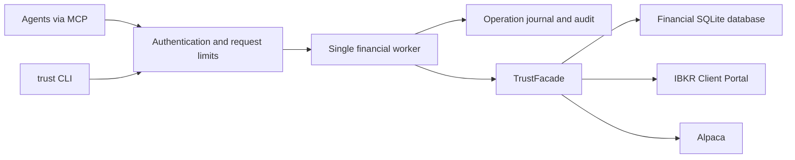

# Trust service and MCP

Trust owns sizing, risk policy, trade state, and the financial ledger. Agents use authenticated tools; they do not receive the database or broker credentials. The default `trust` terminal binary is a thin HTTP client of the same service.



The service is for one owner and multiple agents. It is a single process with one serialized financial worker, not a horizontally scaled broker gateway. Keep exclusive ownership of its financial and control databases. Do not run the legacy CLI or another writer against the service database.

## Authentication and permissions

Use an existing OAuth/OIDC authorization server. Trust is the protected resource, not an authorization server. Register an API audience/resource equal to `https://YOUR_HOST/mcp`. Configure the provider to issue **RS256 access tokens** with `kid`, exact `iss`, that `aud`, a granted `sub`, `iat`, `exp`, and a space-separated `scope`. `nbf` is enforced when present. ID tokens and broker tokens are not Trust credentials.

Use a distinct provider service-account subject for each agent. The server intersects token scopes with the subject's configured scopes and explicit account UUIDs. Use `all_accounts` only for the owner/operator identity. `client_id` or `azp` is recorded as additional attribution. Human OAuth clients should use authorization code with PKCE at the provider; unattended agents use the provider's appropriate service-account flow. Register clients at the provider; Trust does not implement client registration or proxy its login endpoints.

| Scope | Authority |
| --- | --- |
| `trust:read` | Account reads, reporting, market data, own permitted operation/audit results, skills |
| `trust:preview` | Risk, trade, grading, broker, and advisory previews |
| `trust:trade` | Prepare, fund, submit, cancel, close, modify brackets |
| `trust:reconcile` | Broker reconciliation and privileged manual fill accounting |
| `trust:journal` | Session plans, grades, events, catalysts, mistake reviews |
| `trust:policy` | Ledger capital, rules, levels, advisory policy, profit allocations |
| `trust:admin` | Account/instrument administration, audit verification, backup artifacts |

Live mutations require both service `allow_live` and the subject's `allow_live`. Both default to false. Transfers require both accounts; account mutations also check child accounts because closure/reconciliation can distribute profits. Tool discovery reflects granted scopes, and every call checks authorization again. A stored result is re-authorized against its original affected accounts before replay.

Mount the provider's **public** JWKS at `jwks_file`. JWKS keys, grants, token-ID revocations, and configuration are loaded on startup. Rotate public keys with an overlap period and restart; they are not fetched automatically. Remove a grant or add `jti` to `revoked_token_ids` and restart for emergency revocation. There is no token introspection endpoint. Keep access-token lifetimes short; the default maximum is one hour. No OAuth token is forwarded to a broker.

MCP clients discover the authorization server through `/.well-known/oauth-protected-resource/mcp` and the HTTP `WWW-Authenticate` challenge. Connect an OAuth-capable MCP client to `https://YOUR_HOST/mcp`. Protocol handling uses the official [Rust SDK](https://github.com/modelcontextprotocol/rust-sdk), including stateless Streamable HTTP and older initialize-based clients. Configuration follows the MCP [authorization specification](https://modelcontextprotocol.io/specification/2026-07-28/basic/authorization).

## Running the service

1. Copy `deploy/config.example.json` to `deploy/config.local.json`. Set your actual issuer, public origin, subjects, and account grants. Replace placeholder UUIDs after the owner creates account profiles. Never copy a private signing key into this configuration.
2. Put the provider's current public JWKS in `deploy/jwks.json`.
3. Configure your HTTPS reverse proxy to forward to `127.0.0.1:8000`, preserving the **public Host** and Authorization header. No wildcard Hosts or Origins are accepted. Keep `allowed_origins` empty for non-browser clients; add exact origins only when needed.
4. Configure the broker connection and optional secret mounts described below.
5. Run `docker compose -f deploy/compose.yaml up --build -d`. Check `/healthz` and `/readyz`, then authenticate and call `service_status`.

The sample binds only the host loopback port. HTTPS termination is deliberately delegated to your existing proxy. It does not publish a domain, create an IdP, or expose IBKR's gateway. Public URL/issuer must use HTTPS except for a loopback-only local development listener. For a native local process:

```sh
cargo build --locked -p trust-service -p trust-cli
# Use a local config with listen=127.0.0.1:8000 and matching public_url.
./target/debug/trust-service /absolute/path/config.local.json
```

The image runs as UID/GID 10001. The persistent volume, any imported files, and secrets must be readable/writable by that identity as appropriate. It has a read-only root filesystem, dropped capabilities, `no-new-privileges`, memory/CPU/PID limits, a bounded `/tmp`, and a graceful stop period. Database files are created with mode 0600. Use a private directory/volume and encrypted storage. Do not share that volume with agent containers.

The builder uses Rust 1.99.1 and the runtime uses Wolfi with current SQLite, OpenSSL, and native D-Bus libraries. Both base images are pinned by digest. The runtime package inventory is retained for vulnerability scanning. Rebuild with `docker build --pull` when applying dependency updates; changing `Cargo.lock` does not update a running container.

### IBKR

Set `TRUST_IBKR_URL` to the authenticated Client Portal Gateway endpoint, reachable from the container. The sample uses `https://host.docker.internal:5000/v1/api`; configure the gateway/listener and certificate trust for your network. Keep certificate verification enabled. An authenticated Gateway session and appropriate market-data/trading permissions remain operator responsibilities; Trust does not automate IBKR login or bypass MFA.

The adapter requires IBKR's explicit `isPaper` session field to agree with the account environment and rejects missing or conflicting evidence before selecting an account. See [IBKR tradable accounts](https://www.interactivebrokers.com/docs/web-api/api-reference/trading/trading-accounts/get-brokerage-accounts).

The HTTP client disables automatic retries and redirects. A failed mutation returns to the durable operation/reconciliation workflow instead of being automatically repeated or forwarded to another endpoint.

Create the account with `broker: "ibkr"`, the exact `broker_account_id`, and explicit environment. Use `instrument_resolve` to import a contract's native ID; preserve bond terms through `instrument_update`. `broker_preview` uses IBKR's existing `/orders/whatif` integration through the broker trait. Commission and margin amounts have independent currency availability. Missing values, ambiguous ranges, or unknown currencies are not inferred from the trade.

The service retains Client Portal as the working adapter. It does not claim to implement IBKR OAuth2, FIX, TWS, or another provider's full trading framework. Those can be added behind `Broker` while Trust remains the risk authority.

### Alpaca and other secrets

For containers, set `TRUST_ALPACA_CREDENTIALS_FILE` to an individually mounted file whose top-level keys are Trust account UUIDs:

```json
{
  "ACCOUNT_UUID": {
    "environment": "paper",
    "key_id": "PROVIDER_KEY_ID",
    "secret": "PROVIDER_SECRET"
  }
}
```

The adapter selects official paper/live endpoints and rejects environment mismatches. When this variable is set, missing/invalid file entries fail closed; there is no keychain fallback. Existing local keychain use remains available outside containers. Files are operator-managed and never tool results.

Optional service configuration accepts `distribution_password_file` and `calendar_credentials_file`. The latter contains `provider` and `api_key`, using an existing advisor calendar provider. Absent calendar configuration produces the advisor's explicit unavailable/provider warning. Credential setup, rotation, deletion, and inspection are operator workflows, replacing the old agent-facing key commands.

## Agent UX

Start with `service_status`, `policy_get`, and `accounts_list`. Tools use exact IDs, decimal strings, explicit accounts, and descriptive names. The normal workflow is:

`risk_preview → trade_hypothesis → trade_prepare → broker_preview → trade_fund → trade_submit → trade_reconcile`

Preparing does not reserve capital. Funding does not submit an order. Submission is not a fill. `trade_close` requests an exit; reconciliation confirms the resulting state. A broker preview never overrides Trust's sizing and funding checks.

`risk_preview` accounts for short stop collateral and never advertises a level-adjusted size above the enforced base capital/risk ceiling. A monthly rule is enforced even without a per-trade rule. Zero percent deliberately blocks new risk. With no configured rules, only capital, bracket geometry and level constraints apply. Monthly accounting uses UTC boundaries and the ledger's original entry basis for carried positions; it does not measure broker mark-to-market drawdown. Planned stops cannot guarantee realized losses during gaps or slippage.

Manual execution tools (`trade_record_fill`, `trade_record_stop`, `trade_record_target`) require the actual execution `price` and `fee` as exact decimal strings. The price must come from execution evidence. Recording a manual execution persists the filled quantity and actual price for subsequent accounting and reconciliation.

Tools cover the existing workflow families:

| Workflow | Tools |
| --- | --- |
| Accounts/capital | `accounts_list`, `account_get/create/delete`, `balances_get`, `transactions_list`, `capital_deposit/withdraw/transfer` |
| Instruments | `instruments_list/stats`, `instrument_create/update/resolve` |
| Risk/orders | `risk_rules_list`, `risk_rule_create/remove`, `risk_preview`, `trade_hypothesis`, all `trade_*` lifecycle tools, `broker_preview` |
| Reconciliation/evidence | `account_reconcile`, `executions_list`, `trade_audit`, `operation_get`, `audit_list/verify` |
| Reports | `report_get` (summary, performance, drawdown, risk, concentration, metrics, attribution, benchmark, timeline, bias, wash sales, tax), `metrics_get` (advanced, compare, bond) |
| Levels/profit | `level_get/history/progress/evaluate`, `level_policy_get/set`, `distribution_policy_get/set`, `distribution_execute/history` |
| Review/planning | `trade_events_list`, `trade_event_record`, `trade_mistakes_list`, `trade_mistake_record`, `grade_get/preview/record`, `grades_list`, `sessions_list`, `session_open/close` |
| Advisory/market | `advisor_status/check/configure/history/correlation/regime`, `trade_catalysts_scan`, `market_snapshot/bars/quote/trade/session/stream` |
| Operations/skills | `connections_status`, `backup_export/restore`, `skills_list`, `skill_read` |

`GET /v1/tools` or MCP `tools/list` is the authoritative catalog with exact fields. `market_session` reports snapshot context, not an exchange-calendar guarantee. Market streams are finite batches. Advisor history is currently process-local; service audit and mutation outcomes are durable. Tax/wash-sale reports explicitly cover the full ledger. Currency aggregation is rejected when currency conversion would be required.

Three packaged skills are also MCP resources and prompts: `trust-risk`, `trust-operations`, and `trust-admin`. Read `trust://skills/trust-risk`, use `skill_read`, or install the corresponding directory under `skills/` into your agent's skill location. The admin skill is only exposed to identities with admin scope. These workflows guide use; they grant no permissions.

### Results and retries

Every call returns `schema_version`, `request_id`, `operation_id`, `data`, `error`, and `next_actions`. Errors have stable `code`, safe `message`, `next_action`, and `retryable`. Array reads use `items`, `total`, and `next_offset`; defaults return 100 items, maximum 200. Nested reports are limited by the total response budget; narrow queries when needed.

Every mutation requires a unique `idempotency_key` (8–128 characters). A key is scoped to the authenticated subject and permanently bound to its exact tool/arguments. Use the same key and arguments after a timeout. Different arguments with the same key are a conflict. Different agents should not independently issue the same financial intent; core trade state/intent validation remains the second protection.

The journal commits intent before dispatch and commits the result afterward. An interrupted `running` operation becomes `outcome_unknown` on restart and is never automatically replayed. Broker failures after dispatch are conservatively uncertain unless a typed domain validation proves rejection. Use `operation_get` and reconcile; do not create another key to bypass uncertainty. Financial SQLite, control SQLite, and a remote broker cannot share an atomic transaction. This design does not claim exactly-once external execution.

### Fractional risk policy migration

Migration `2026-10-26-000001_preserve_fractional_risk` adds a decimal-string column while preserving existing integer policy values. It is an additive startup upgrade, with paired migration files and backup/restore tests. Downgrade refuses policies that would lose a fraction. Older backups still require a matching migration manifest: restore with their matching schema and then migrate the database.

Earlier storage truncated fractional percentages: a requested `0.3` could already be stored as `0`. The migration cannot reconstruct lost input. Inspect existing risk rules and deliberately correct them if needed; migration never increases a policy automatically. New percentages must round-trip through the legacy model boundary without changing their decimal value.

Run `make reliability` for the offline suite and named-test evidence. The [feature inventory](reliability/features.md), [edge-case register](reliability/edge-cases.md), and [verification record](reliability/verification.md) describe covered behaviors and remaining external acceptance work.

### Thin terminal client

```sh
export TRUST_SERVICE_URL=https://trust.example.com
export TRUST_ACCESS_TOKEN_FILE=/run/secrets/trust-access-token
trust status
trust tools
trust skill trust-risk
printf '%s\n' '{"account_id":"ACCOUNT_UUID","entry":"100","stop":"95"}' | trust call risk_preview
trust call trade_prepare --input draft.json
```

The CLI has no broker/database commands in its default entry point. It accepts tokens through a file, rejects credential-bearing URLs, and does not follow redirects with Authorization. Results are JSON. Obtain/refresh its access token using your provider's client tooling.

The historical CLI is retained solely as `trust-legacy` behind `--features legacy-cli`, including its JSON snapshot suite. Its command syntax is documented in [the legacy reference](legacy-cli-reference.md). Do not run it against a service-owned database. Deleting that implementation can be a later cleanup once migration users no longer need it.

## Audit, logging, and operations

Structured JSON logs go to stdout with request ID, tool, status, and latency. They omit Authorization, raw paths/queries, arguments, and broker response bodies. Production logging enables service events only. Container log rotation is configured; ship retained logs to your existing collector if needed.

The control database stores subject/client attribution, request/operation IDs, tool, account, outcome, and content hashes in an append-only hash chain. Mutation responses contain financial data and must be protected like the ledger. Audit write failure stops the worker. Startup verifies the chain. Chain verification detects ordinary changes; an attacker with storage control can rewrite/truncate the whole chain, so retain external head hashes or trusted backups for stronger evidence.

Request bodies are limited to 128 KiB, results to 1 MiB, concurrent HTTP requests to 32, the worker queue to 64 by default, total requests to 600/minute and each subject to 120/minute. Broker/network delays can cause `outcome_unknown` responses while the worker completes its durable operation. SIGTERM stops accepting HTTP requests and lets work finish; forcibly terminating it leaves recoverable unknown intents.

Background reconciliation runs independently of MCP connections, when configured, rotating through one active trade per interval. `account_reconcile` processes a bounded page (default 1, maximum 5); follow `next_after_trade_id` with a new key for the next page. Failures are recorded per trade and a batch's `complete` flag must be checked. The current synchronous adapters serialize broker I/O; a large account can delay other operations. Use an operator monitor for readiness, unresolved operations, and reconciliation failures. The service is not a substitute for broker-native protective orders.

For disaster recovery, stop the service and back up the financial database, control database (including SQLite WAL state if present), and configuration together; protect secrets separately. `backup_export` creates an opaque server-owned financial JSON artifact, not a full deployment backup. Online `backup_restore` is strict import into an empty financial database. In-place replacement must be performed offline after broker reconciliation; restoring a database cannot undo a live order. Keep the control journal to avoid forgetting past keys.

## Validation

Dependency maintenance covers the Rust toolchain, all workspace manifests and the lockfile, container images, and GitHub Actions. Dependabot proposes weekly Cargo, Docker, and action updates; CI also runs weekly to detect new advisories. Actions and base images use immutable pins. Security tools use explicit versions and locked installation.

`cargo audit --deny warnings` and `cargo deny --all-features check` are blocking checks with no advisory exceptions. The production image must pass a high/critical vulnerability scan, including findings without a published fix. Native credential access uses `keyring-core` and explicit maintained OS backends; it preserves service/username identifiers and never falls back to an in-memory store on initialization failure.

Rusqlite is on 0.40.2 because Diesel 2.3.14 requires `libsqlite3-sys <0.39`, while Rusqlite 0.41 requires 0.39. Upgrade them together when their native-library requirements agree. This compatibility constraint is recorded in `service/Cargo.toml`; it does not suppress an advisory. Regression fixtures verify password hashes and audit/idempotency digests produced by the previous crypto libraries.

```sh
cargo fmt --all -- --check
cargo clippy --workspace --all-targets --all-features -- -D warnings
cargo test --locked -p trust-service -- --test-threads=1
cargo test --locked --workspace --all-features -- --test-threads=1
cargo test --locked -p trust-cli --features legacy-cli --test integration_test_report_json_snapshots -- --test-threads=1
make security-check
actionlint
bash .github/test_workflow_integration.sh
bash .github/test_version_parsing.sh
docker compose -f deploy/compose.yaml config --quiet
docker build -t trust-service:local .
trivy image --scanners vuln --severity HIGH,CRITICAL --exit-code 1 trust-service:local
```

Tests use generated signing keys and fake brokers; they never connect to live brokerage accounts. Live IBKR/paper end-to-end tests remain explicit ignored tests under the repository's existing operator workflow.
